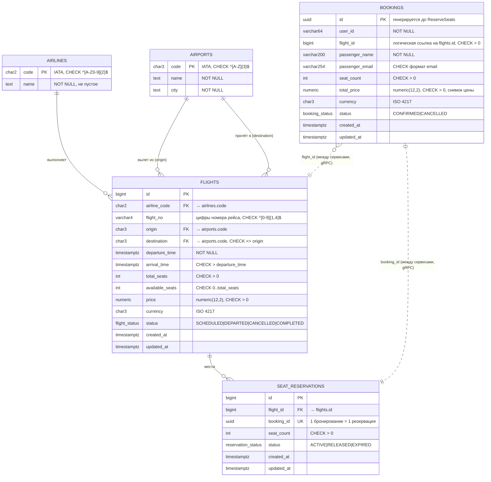

# ER-диаграмма

Две независимые БД: `flights` (Flight Service) и `bookings` (Booking Service).
Связь `bookings.flight_id → flights.id` и `seat_reservations.booking_id → bookings.id`
существует только логически (через gRPC): внешний ключ между разными БД невозможен.

## Ограничения целостности

| Таблица | Ограничение |
|---|---|
| flights | `UNIQUE (airline_code, flight_no, (departure_time AT TIME ZONE 'UTC')::date)` — номер рейса + дата вылета уникальны |
| flights | `total_seats > 0`, `price > 0`, `available_seats >= 0`, `available_seats <= total_seats` |
| flights | `origin <> destination`, `arrival_time > departure_time` |
| flights | FK на `airlines`, `airports` (origin и destination) |
| seat_reservations | `UNIQUE (booking_id)`, `seat_count > 0`, FK на `flights` |
| bookings | `seat_count > 0`, `total_price > 0`, `flight_id > 0`, формат email, непустые `user_id` и `passenger_name` |
| все | статусы — PostgreSQL `ENUM`, недопустимое значение не записать |

## Почему это 3NF

* **1NF** — все атрибуты атомарны: номер рейса разделён на `airline_code` + `flight_no`,
  цена — число + код валюты, нет списков в колонках.
* **2NF** — у каждой таблицы суррогатный первичный ключ из одного атрибута; у `flights`
  есть ещё составной потенциальный ключ (авиакомпания, номер, дата вылета), и ни один
  неключевой атрибут не зависит от его части. Если бы хранился полный номер `SU1234`
  вместе с `airline_code`, то `airline_code` зависел бы от части ключа — поэтому
  хранится только числовая часть номера.
* **3NF** — нет транзитивных зависимостей: название авиакомпании вынесено в `airlines`,
  название и город аэропорта — в `airports`; в `flights` остались только коды (FK).
  `bookings` не дублирует данные рейса (маршрут, время) — только `flight_id`.

Осознанные решения, которые не нарушают 3NF, но стоит пояснить:

* `flights.available_seats` формально выводится из `total_seats − Σ seat_count` активных
  резерваций. Это требование задания и счётчик, который блокируется `SELECT … FOR UPDATE`
  при резервировании; согласованность обеспечивает транзакция и `CHECK`.
* `bookings.total_price` — не производное от текущей цены рейса, а **снимок** цены на
  момент бронирования (цена рейса может измениться позже).
* `passenger_name`/`passenger_email` — данные пассажира конкретного бронирования
  (один пользователь бронирует на разных людей), а не атрибуты `user_id`.
