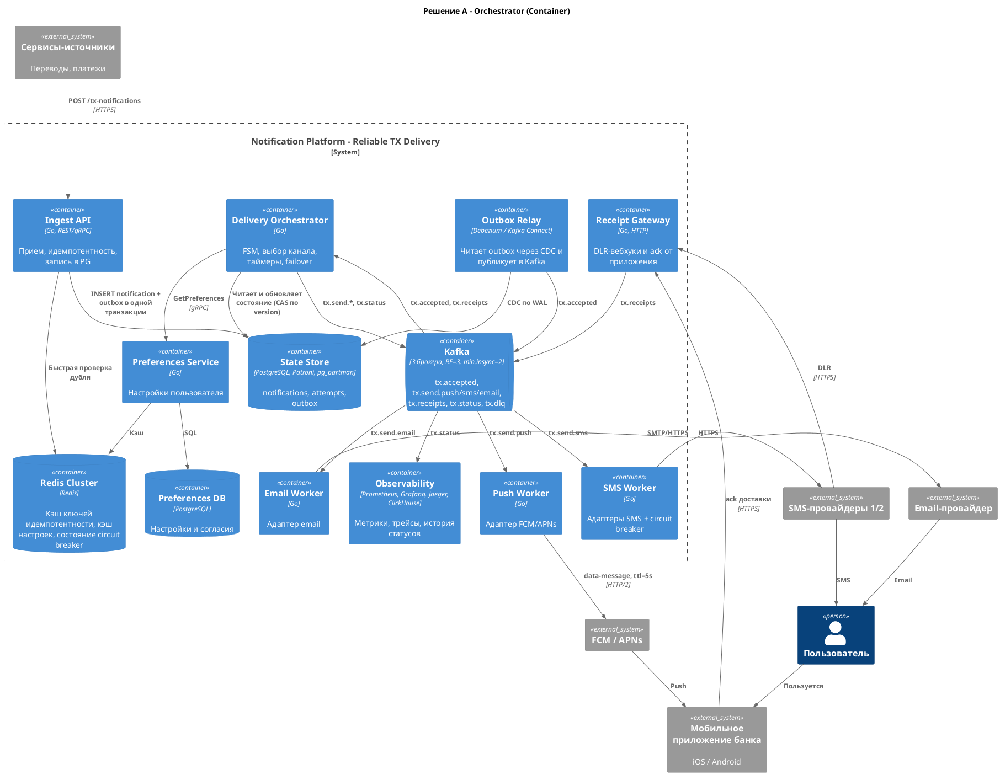
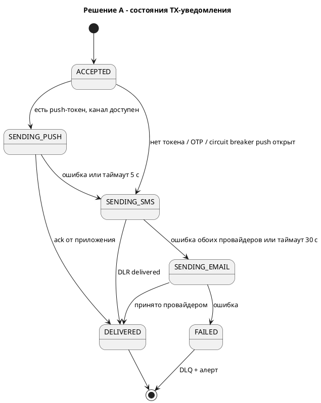
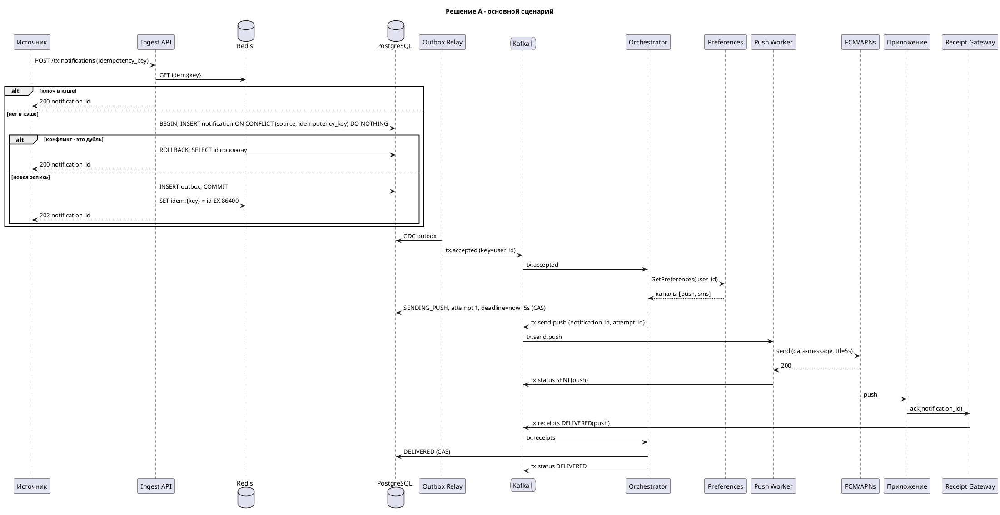
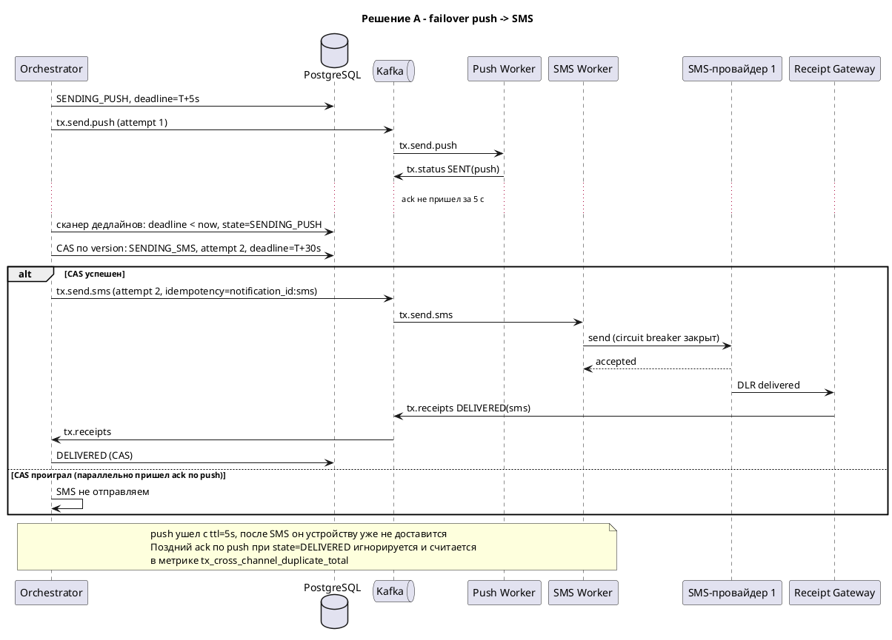
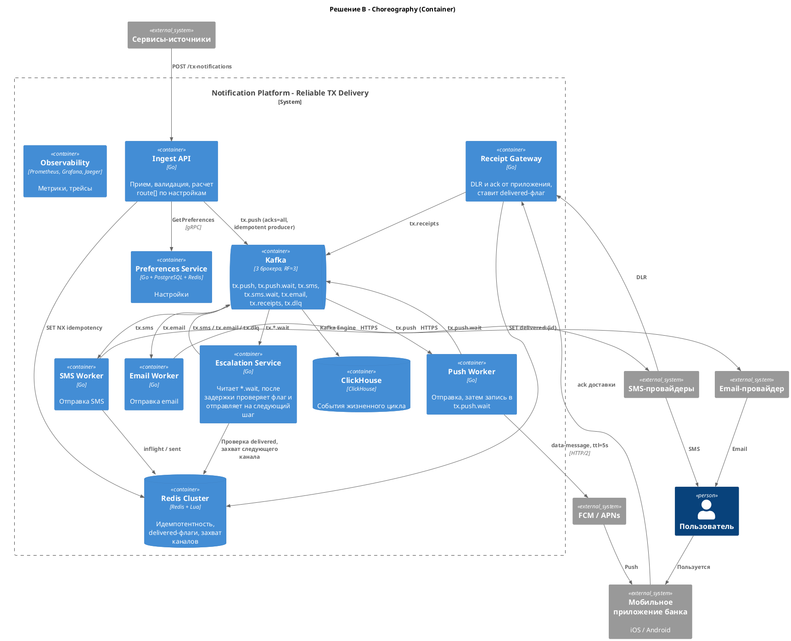
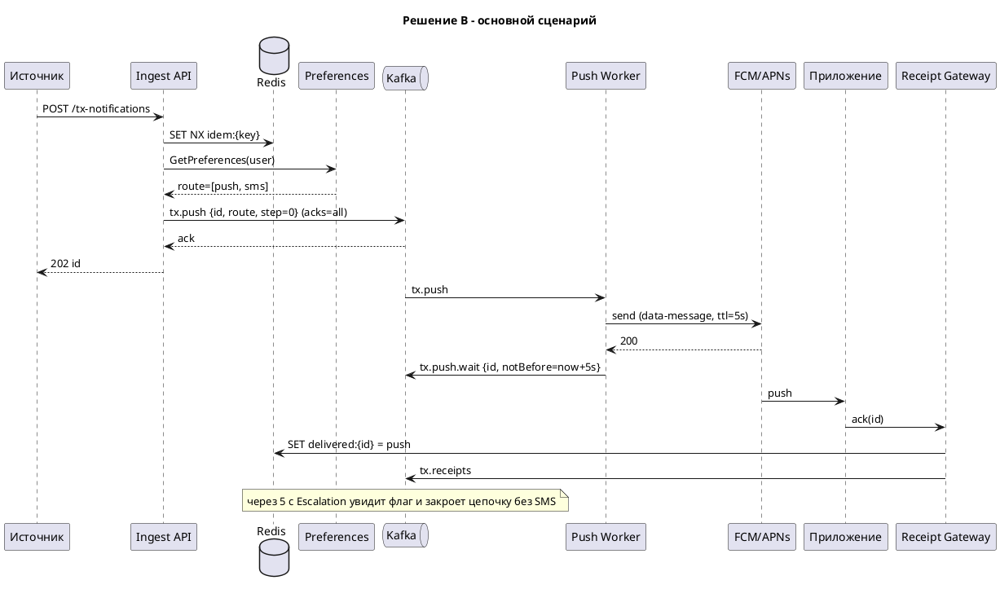
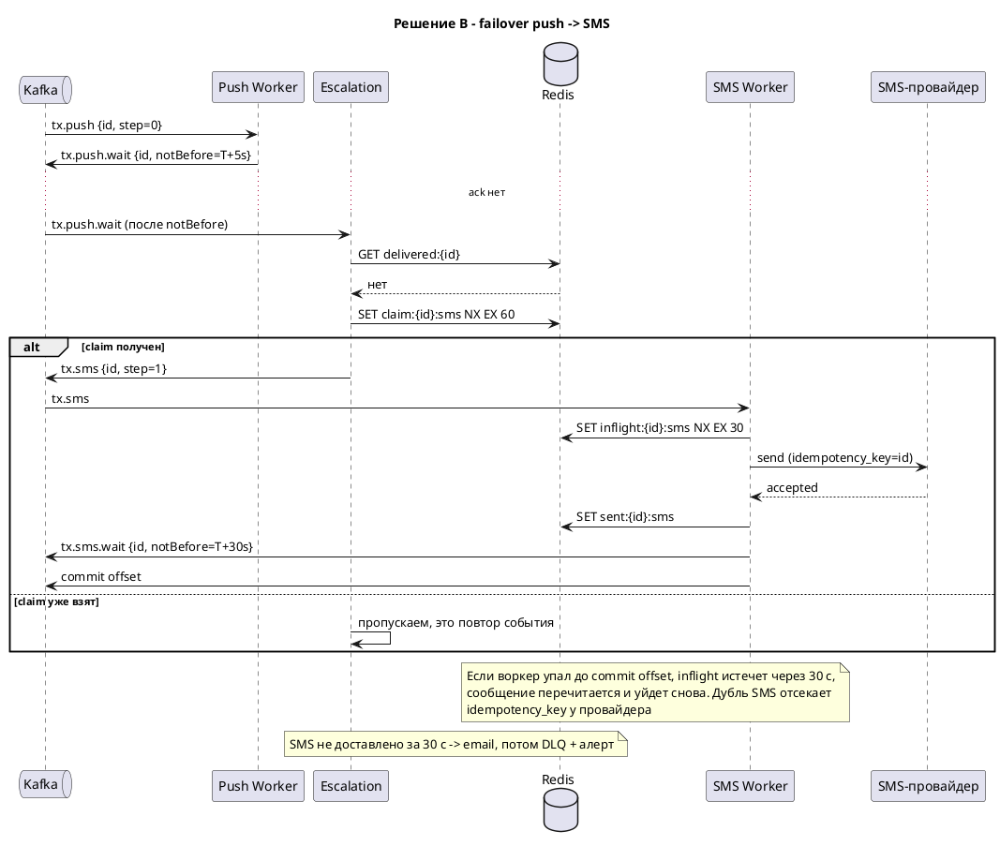

# ДЗ №4. Notification Platform - требования и архитектурное мышление

Сокращения: TX - транзакционные, SVC - сервисные, MKT - маркетинговые уведомления

---

## 1. Функциональные требования

| ID | Требование | Бизнес-цель |
|----|------------|-------------|
| FR-1 | Как сервис-источник (переводы, карты, кредиты, акции) я отправляю уведомление в единую платформу и указываю только тип, получателя и содержание, про каналы и провайдеров ничего не знаю. Повторная отправка того же события не создает второе уведомление | Централизованный контроль |
| FR-2 | Как пользователь я гарантированно получаю TX-уведомление (списание, перевод) хотя бы по одному каналу. Если основной канал не сработал, платформа сама досылает по резервному | Гарантированная доставка критичных |
| FR-3 | Как пользователь я включаю и выключаю SVC и MKT, выбираю предпочитаемый канал и задаю тихие часы. TX отключить нельзя | Жалобы -30% |
| FR-4 | Как пользователь я получаю одно уведомление на одно событие, даже если источник повторил запрос или сработал резервный канал | Жалобы -30% |
| FR-5 | Как маркетолог я запускаю кампанию на сегмент до 1 млн пользователей по расписанию, ограничиваю частоту (не больше N MKT в день на пользователя) и могу остановить кампанию | Retention +15%, жалобы |
| FR-6 | Платформа выбирает канал с учетом приоритета, настроек пользователя и стоимости (push дешевле SMS) | Стоимость, retention |
| FR-7 | Как сотрудник поддержки я вижу историю каждого уведомления: когда принято, по какому каналу ушло, доставлено или нет и почему. Как аналитик - сводные показатели доставки | Контроль, разбор жалоб |
| FR-8 | Как сервис-источник я узнаю итоговый результат доставки критичного уведомления, чтобы при недоставке что-то сделать (показать статус в приложении, запросить подтверждение повторно) | Гарантированная доставка |
| FR-9 | Как пользователь я отписываюсь от MKT одним действием (ссылка, кнопка, STOP в SMS), отписка действует сразу | Жалобы -30% |

Что можно отключать: MKT - полностью; SVC - по подтипам (напоминания, статусы), кроме статусов заявок, по которым от пользователя требуется действие; TX - нельзя, можно только выбрать предпочитаемый канал

---

## 2. Нефункциональные требования

| ID | Категория | Требование |
|----|-----------|------------|
| NFR-1 | Latency | TX: прием -> передача push-провайдеру ≤ 1 с (p99), доставка push на устройство ≤ 3 с (p99), доставка SMS при failover ≤ 15 с от приема (p99). SVC ≤ 30 с, MKT - в окне кампании |
| NFR-2 | Throughput | 5 000 уведомлений/с в пике (расчет в п.3); кампания на 1 млн за ≤ 15 мин (~1 100/с) без деградации TX |
| NFR-3 | Availability | API приема TX - 99.95% в месяц (~22 мин простоя); отказ одной AZ не приводит к потере принятых сообщений |
| NFR-4 | Durability | 0 потерянных TX после подтверждения приема (RPO = 0, не меньше 3 копий); ≥ 99.99% TX доставлены хотя бы по одному каналу при отказе одного провайдера |
| NFR-5 | Дубли | повторная доставка по одному и тому же каналу ≤ 0.01%; одно TX пришло и push, и SMS (кросс-канальный дубль) ≤ 0.5% |
| NFR-6 | Изоляция | пик MKT увеличивает p99 TX не больше чем на 10% |
| NFR-7 | Failover | отказ провайдера обнаруживается ≤ 10 с, переключение автоматическое; таймаут ожидания подтверждения push перед переходом на SMS - 5 с (настраивается) |
| NFR-8 | Scalability | рост нагрузки в 3 раза закрывается горизонтальным масштабированием без смены архитектуры |
| NFR-9 | Observability | у каждого уведомления сквозной notification_id; метрики по каналам и провайдерам; алерт ≤ 1 мин, если доля доставленных TX упала ниже 99% |
| NFR-10 | Security | телефон и email шифруются at-rest и in-transit; история хранится 180 дней; отписка применяется ≤ 1 с |
| NFR-11 | Cost | SMS ≤ 5% от TX в штатном режиме (только как резерв); стоимость на 1000 TX отслеживается |

---

## 3. Архитектурно значимые требования (ASR)

**ASR-1 (High): гарантированная доставка критичных уведомлений**
- Связанные: FR-2, FR-8, NFR-4, NFR-7, NFR-11
- Почему влияет: намерение доставить надо надежно записать до ответа источнику, а дальше вести уведомление по конечному автомату с таймаутами и переходами между каналами. От этого зависят хранилище состояния, модель обмена (асинхронная, но через durable-очередь) и появление отдельного оркестратора. Fire-and-forget сразу отпадает

**ASR-2 (High): низкая задержка TX при пиках кампаний**
- Связанные: FR-5, NFR-1, NFR-2, NFR-6
- Почему влияет: потоки придется разделять по классам (отдельные очереди и пулы воркеров), кампании - ограничивать по скорости, а критический путь TX делать коротким, с минимумом синхронных вызовов

**ASR-3 (High): нет дублей при ретраях и failover**
- Связанные: FR-4, NFR-5
- Почему влияет: at-least-once в распределенной системе неизбежно дает повторы. Нужны общий механизм дедупликации (ключ идемпотентности, атомарный захват отправки по каналу) и одна точка, где принимается решение о failover

**ASR-4 (Medium): устойчивость к нестабильным провайдерам**
- Связанные: NFR-3, NFR-7, NFR-11
- Почему влияет: нужны абстракция провайдера, circuit breaker, health-проверки, ретраи с backoff и jitter, несколько провайдеров на канал

**ASR-5 (Medium): соблюдение настроек и юридических ограничений**
- Связанные: FR-3, FR-9, NFR-10
- Почему влияет: настройки проверяются при каждой отправке, значит, это должно быть быстро (кэш) и при этом согласованно (отписка действует сразу). Это определяет модель хранения и инвалидацию кэша

**ASR-6 (Medium): наблюдаемость всего процесса**
- Связанные: FR-7, NFR-9
- Почему влияет: нужен отдельный поток событий жизненного цикла, trace-контекст через очереди и отдельное аналитическое хранилище

### Оценка нагрузки

- 3 млн DAU × 10 = 30 млн уведомлений/сутки: TX 6 млн, SVC 9 млн, MKT 15 млн
- в среднем 30 млн / 86 400 ≈ 350/с. Трафик неравномерный: ~90% приходится на 14 дневных часов (×1.7), сверху часовые пики - обед, вечер, зарплатные дни (×3-5). Берем пик ×10 ≈ 3 500/с, с запасом 5 000/с
- проверка через PCU: 300 тыс. онлайн одновременно, если 10% из них делают операцию раз в минуту, получается 30 тыс./мин ≈ 500 TX/с. С оценкой ниже сходится
- TX: 6 млн/сутки ≈ 70/с, пик ≈ 700/с
- кампания 1 млн за 15 мин ≈ 1 100/с поверх фона
- failover максимум удваивает число попыток по TX: до 1 400 попыток/с, с запасом ×3 - около 4 200/с
- MAU 10 млн: настройки и до 3 push-токенов ≈ 1-2 КБ на пользователя, итого 10-20 ГБ, целиком помещается в Redis
- хранение: запись ~1 КБ + ~4 события по 200 Б ≈ 2 КБ на уведомление, то есть 60 ГБ/сутки и ~11 ТБ за 180 дней. Значит, в OLTP держим только горячие данные, полную историю - в колоночном хранилище

---

## 4. Ключевые архитектурные вопросы

| # | Вопрос | Откуда | Почему важен |
|---|--------|--------|--------------|
| Q1 | В какой момент TX считается принятым и как гарантировать, что оно не потеряется, не раздувая задержку? | ASR-1, ASR-2, NFR-4 | Определяет брокер, режим записи (acks, репликация) и контракт ответа источнику |
| Q2 | Кто решает про failover (оркестратор или хореография) и как понять, что push не доставлен, если FCM/APNs подтверждений не дают? | ASR-1, ASR-3, ASR-4 | Ошибка дает либо лишние SMS (деньги и дубли), либо недоставку |
| Q3 | Как изолировать TX от MKT: общие или раздельные очереди, воркеры, кластеры? | ASR-2, NFR-6 | Баланс стоимости инфраструктуры и гарантии SLA |
| Q4 | Где и как хранить ключи идемпотентности, чтобы не было гонок между инстансами и каналами? | ASR-3, NFR-5 | Дубли - главный источник жалоб |
| Q5 | Как проверять настройки при 5 000 rps без нагрузки на основную БД и при этом с мгновенной отпиской? | ASR-5, NFR-10 | Кэш против консистентности, юридические риски |
| Q6 | Как устроить абстракцию провайдеров (несколько на канал, circuit breaker, маршрутизация по стоимости)? | ASR-4, NFR-11 | Границы модулей и стратегия деградации |

---

## 5. Архитектурные последствия ASR

**ASR-1:**
- реплицируемый брокер (acks=all) как durable-журнал
- transactional outbox на стороне платформы
- конечный автомат доставки (ACCEPTED -> SENDING(канал) -> DELIVERED, по таймауту - следующий канал, в конце FAILED) с персистентным состоянием и таймерами
- DLQ и повторная обработка
- прием подтверждений доставки: DLR от SMS-провайдеров и ack от мобильного приложения

**ASR-2:**
- асинхронная обработка, отдельные топики для TX/SVC/MKT
- отдельные пулы воркеров, автоскейлинг по lag
- rate limiting кампаний и квоты на продюсеров MKT
- короткий синхронный путь: валидация -> durable-запись -> ответ

**ASR-3:**
- ключ идемпотентности от источника, уникальный индекс в БД как источник истины, Redis как быстрый фильтр
- захват попытки отправки через версию записи (CAS)
- один владелец состояния уведомления (партиционирование по user_id)
- idempotency-ключи провайдеров, где они есть; TTL у push, чтобы устаревший push не пришел после SMS

**ASR-4:**
- адаптер на каждого провайдера, по 2 провайдера на SMS
- circuit breaker с общим состоянием, retry с exponential backoff и jitter
- bulkhead - отдельные пулы под провайдеров

**ASR-5:**
- Preferences Service с кэшем в Redis и инвалидацией по событию изменения настроек
- правило "TX не отключаются" зашито в коде, а не в данных
- хранение согласий для аудита

**ASR-6:**
- каждый переход состояния публикуется в топик статусов
- OpenTelemetry trace-context в заголовках сообщений
- Prometheus для метрик, ClickHouse для аналитики статусов, дашборды и алерты

---

## 6. Архитектурные решения, которые НЕ подходят

| # | Решение | Какой ASR нарушает | Почему |
|---|---------|--------------------|--------|
| 1 | Синхронная отправка из сервиса-источника прямо провайдеру (как сейчас) | ASR-1, ASR-2, ASR-4 | Тормозящий провайдер блокирует сам перевод, нет ретраев и failover, при падении сервиса посреди вызова уведомление теряется |
| 2 | Одна общая очередь и один пул воркеров на все типы | ASR-2 | Кампания на 1 млн забивает очередь, TX стоят за MKT (head-of-line blocking), SLA 3 с не выполнить |
| 3 | Отправка TX сразу по всем каналам "на всякий случай" | ASR-3, NFR-11 | Гарантированные дубли и SMS на каждое сообщение: при 6 млн TX/сутки это ~18 млн ₽/сутки |
| 4 | Очередь на таблице OLTP-БД с поллингом (SELECT ... FOR UPDATE SKIP LOCKED на 5 000 rps) | ASR-2, ASR-6 | Горячая таблица, bloat, конкуренция блокировок, мешает чтениям поддержки |
| 5 | Fire-and-forget, at-most-once | ASR-1 | Падение воркера = потерянное TX |

---

## 7. Неопределенности и архитектурные риски

| # | Что неизвестно | Риск | Как проверить |
|---|----------------|------|---------------|
| U1 | Надежность провайдеров и доля push, на которые приложение реально успевает отправить ack (FCM/APNs сами доставку на устройство не подтверждают) | Не отличить "push не дошел" от "ack потерялся" -> лишние SMS или недоставка | PoC: замерить долю ack и распределение задержек, по p95/p99 подобрать таймаут, посчитать цену ложного failover |
| U2 | Реальные пики (одновременные кампании, черная пятница, зарплатные дни) и правда ли пик ×10 | Недо- или перепровизионирование, нарушение NFR-6 | Нагрузочные тесты (k6) со сценарием "кампания + пик TX", анализ исторических данных текущих сервисов |
| U3 | Квоты и тарифы провайдеров (RPS SMS-шлюза, лимиты FCM/APNs) | Кампания или массовый failover упирается в квоты, перерасход бюджета | Запросить квоты и тарифы, тест на sandbox, модель затрат при доле SMS 1% / 5% / 20% |
| U4 | Юридические требования: какие уведомления обязательны, сроки хранения, согласия | Штрафы, переделка модели настроек | Согласовать с юристами и compliance до проектирования схемы настроек |
| U5 | Готовы ли источники к единому контракту и ключам идемпотентности | Дубли на входе | Инвентаризация источников, пилот с 1-2 командами |

---

# 8. RFC: Гарантированная доставка критичных уведомлений с кросс-канальным failover

| Метаданные | Значение |
|------------|----------|
| **Статус** | DESIGN |
| **Автор(ы)** | Уинстон Смит |
| **Ответственный** | О'Брайен |
| **Бизнес-заказчик** | Большой Брат |
| **Ревьюеры** | Большой Брат, 1984-04-13 |
| **Дата создания** | 1984-04-11|
| **Дата обновления** | 1984-04-12 |

---

## Оглавление

1. [Контекст](#81-контекст)
2. [Продуктовый анализ](#82-продуктовый-анализ)
3. [Пользовательские сценарии](#83-пользовательские-сценарии)
4. [Статистика](#84-статистика)
5. [Требования](#85-требования)
6. [Варианты решения](#86-варианты-решения)
7. [Сравнительный анализ](#87-сравнительный-анализ)
8. [Выводы](#88-выводы)
9. [Связанные задачи](#89-связанные-задачи)
10. [Приложения](#810-приложения)

---

## 8.1. Контекст

TX-уведомления (подтверждение перевода, списание) критичны, их недоставка бьет по безопасности и доверию. Сейчас каждая команда шлет их сама: нет гарантий доставки, бывают дубли, нет контроля. Провайдеры работают нестабильно, SMS намного дороже push

RFC детализирует ASR-1 и ASR-3 из п.3 применительно к одной подсистеме Notification Platform - гарантированной доставке TX с автоматическим переходом между каналами

### Ключевые вопросы
- **Какую проблему решаем?** TX может не дойти (упал провайдер, протух push-токен, устройство офлайн), а простое "слать по всем каналам" дает дубли и дорогие SMS на каждое сообщение
- **Почему это важно сейчас?** Платформа строится с нуля, и TX - самый критичный поток. Пока нет гарантированной доставки с failover, переводить на платформу источники TX нельзя
- **Кто затронут?** Пользователи (10 млн MAU), сервисы-источники (переводы, платежи, карты), поддержка (разбор жалоб), мобильная команда (ack в приложении), финансы (расходы на SMS)

### Цели и не-цели

Цели: доставка хотя бы по одному каналу, автоматический failover, учет настроек пользователя, минимальная стоимость, наблюдаемость, отсутствие дублей при failover

Не-цели: маркетинговые кампании и сегментация, шаблонизатор (считаем готовым), собственный SMS-шлюз

---

## 8.2. Продуктовый анализ

- Сейчас TX шлют синхронно из сервисов-источников прямо провайдеру (решение 1 из п.6): тормозящий провайдер блокирует сам перевод, failover нет, поддержка не видит, что ушло пользователю
- Бизнес-цели: гарантированная доставка критичных уведомлений, снижение жалоб на 30% (недоставка и дубли - основные причины), контроль стоимости
- Метрики успеха:
  - ≥ 99.99% TX доставлены хотя бы по одному каналу при отказе одного провайдера
  - доля SMS ≤ 5% TX в штатном режиме
  - кросс-канальные дубли ≤ 0.5%
  - поддержка находит историю любого TX по notification_id
- Экономика: SMS ≈ 3 ₽, push ≈ 0. Отправка SMS параллельно с push на каждое TX стоит ~18 млн ₽/сутки, SMS только как резерв (~3%) - ~540 тыс. ₽/сутки. Цена экономии - в ~3% случаев уведомление приходит на ~5 с позже

Что можно отключать (из п.1): TX отключить нельзя, ни целиком, ни все каналы сразу, можно только выбрать предпочитаемый канал

---

## 8.3. Пользовательские сценарии

| Приоритет | Тип сценария | Действующее лицо | Сценарий |
|-----------|--------------|------------------|----------|
| MUST HAVE | Основной | Сервис-источник | Отправляет TX с idempotency_key, получает 202 и notification_id. Повтор того же запроса возвращает тот же notification_id, второго уведомления нет |
| MUST HAVE | Основной | Пользователь | Получает push о списании за ≤ 3 с |
| MUST HAVE | Failover | Пользователь | Push не подтвержден за 5 с - получает SMS за ≤ 15 с от приема. Устаревший push после SMS не приходит |
| MUST HAVE | Failover | Платформа | FCM недоступен - circuit breaker открыт, TX сразу идут в SMS без ожидания push |
| MUST HAVE | Failover | Платформа | Все каналы исчерпаны - уведомление в DLQ, дежурный получает алерт |
| MUST HAVE | Настройки | Пользователь | Выбирает предпочитаемый канал для TX. Отключить TX нельзя |
| SHOULD HAVE | Срочные | Пользователь | OTP и подтверждение 3-DS приходят сразу SMS |
| SHOULD HAVE | Обратная связь | Сервис-источник | Узнает итоговый статус TX (DELIVERED / FAILED), чтобы при недоставке показать статус в приложении |
| SHOULD HAVE | Разбор | Сотрудник поддержки | По notification_id видит все попытки: канал, провайдер, время, результат |
| COULD HAVE | Аналитика | Аналитик | Видит воронку доставки по каналам и расходы на SMS |
| COULD HAVE | Несколько устройств | Пользователь | Получает push на все свои устройства, доставленным считается по ack с любого |

---

## 8.4. Статистика

Входные данные:
- MAU 10 млн, DAU 3 млн, Peak Concurrent Users 300 тыс.
- в среднем на пользователя в день: TX 2, SVC 3, MKT 5, итого ~10
- всего 30 млн уведомлений/сутки, из них TX - 6 млн

Допущения, которые нужно подтвердить на PoC (U1, U3):
- доля push, по которым приложение успевает прислать ack, ~97%, то есть штатный failover ~3% (протух токен, устройство офлайн)
- при инциденте с FCM failover вырастает до 20% и выше
- вызов провайдера ~50 мс

---

## 8.5. Требования

### Функциональные требования

| № | Приоритет | Обозначение | Требование |
|---|-----------|-------------|------------|
| 1 | MUST HAVE | FR1 | Прием TX с ключом идемпотентности, ответ источнику только после надежной записи |
| 2 | MUST HAVE | FR2 | Цепочка каналов: предпочитаемый -> push -> SMS -> email с учетом настроек. Отключить TX или все каналы для TX нельзя |
| 3 | MUST HAVE | FR3 | Переход на следующий канал при ошибке провайдера или если подтверждение не пришло за таймаут |
| 4 | MUST HAVE | FR4 | Подтверждение доставки по любому каналу завершает процесс, остальные попытки отменяются |
| 5 | MUST HAVE | FR5 | Если каналы кончились - DLQ и алерт |
| 6 | SHOULD HAVE | FR6 | Статус доставки доступен источнику и поддержке |
| 7 | SHOULD HAVE | FR7 | Для отдельных типов (OTP, подтверждение 3-DS) сразу SMS, без ожидания push |

### Нефункциональные требования

| № | Приоритет | Обозначение | Требование |
|---|-----------|-------------|------------|
| 1 | MUST HAVE | NFR1 | Latency: прием p99 ≤ 100 мс; push p99 ≤ 3 с; SMS после failover ≤ 15 с от приема (5 с ожидание push + отправка SMS) |
| 2 | MUST HAVE | NFR2 | Throughput: пик 700 TX/с, проектируем с запасом ×3 на ~2 100/с; попыток отправки до ~4 200/с (худший случай - отказ FCM) |
| 3 | MUST HAVE | NFR3 | Durability: 0 потерянных TX после подтверждения приема (RPO = 0) |
| 4 | MUST HAVE | NFR4 | Дубли как в NFR-5: ≤ 0.01% в канале, ≤ 0.5% кросс-канальных |
| 5 | MUST HAVE | NFR5 | Availability: доступность приема 99.95% в месяц |
| 6 | MUST HAVE | NFR6 | Failover: отказ провайдера обнаруживается ≤ 10 с, таймаут ожидания push - 5 с (настраивается) |
| 7 | SHOULD HAVE | NFR7 | Cost: SMS ≤ 5% TX в штатном режиме |
| 8 | SHOULD HAVE | NFR8 | Observability: сквозной notification_id, метрики по каналам и провайдерам, алерт ≤ 1 мин, если доля доставленных TX ниже 99% |
| 9 | SHOULD HAVE | NFR9 | Scalability: рост ×3 закрывается горизонтальным масштабированием |

### Архитектурно значимые требования (ASR)

| ASR | Приоритет | Связанные требования |
|-----|-----------|----------------------|
| A1. Доставка хотя бы по 1 каналу | P0 | FR1, FR2, FR3, FR5, NFR3 |
| A2. Задержка TX ≤ 3 с в пик | P0 | NFR1, NFR2 |
| A3. Нет дублей при failover | P0 | FR1, FR4, NFR4 |
| A4. Устойчивость к отказам провайдеров | P1 | FR3, NFR5, NFR6 |
| A5. Минимальная стоимость (SMS только как резерв) | P1 | FR2, FR7, NFR7 |
| A6. Наблюдаемость | P1 | FR6, NFR8 |

**Расчёт нагрузок:**
```
TX:        6 млн/сутки ≈ 70/с, пик ×10 = 700/с, проектируем на 2 100/с
Failover:  штатно ~3% -> 180 тыс. SMS/сутки
           инцидент с FCM (20%) -> 1.2 млн SMS/сутки
Стоимость: SMS ≈ 3 ₽, push ≈ 0
           3% failover -> ~540 тыс. ₽/сутки
           SMS всем параллельно -> 18 млн ₽/сутки, экономически не проходит

БД состояния: ~5 записей на TX (notification, outbox, attempt, 2 обновления статуса)
           700 × 5 ≈ 3 500 TPS в пик, с запасом ×3 ~10 тыс. TPS
           -> один primary PostgreSQL на NVMe, шардирование с первого дня не нужно
Хранение:  горячие TX за 7 дней: 6 млн × 2 КБ × 7 ≈ 84 ГБ
           старше -> ClickHouse, 180 дней ≈ 2.2 ТБ

Kafka:     700 msg/с × 1 КБ ≈ 0.7 МБ/с, по всем топикам (accepted, send, receipts, status) ×5 ≈ 3.5 МБ/с
           ограничивает параллелизм консьюмеров, а не пропускная способность
Воркеры:   вызов провайдера ~50 мс, 10 параллельных запросов на инстанс -> ~200 отправок/с
           4 200 попыток/с -> ~21 инстанс
           tx.send.push и tx.send.sms по 24 партиции, tx.send.email - 12
           внутри партиции параллельно с сохранением порядка по ключу (confluent parallel-consumer)
Таймеры:   2 100/с × 5 с ≈ 10 тыс. активных дедлайнов
           большая часть закрывается ack, истекает ~3% -> ~20/с в штатном режиме
Массовый отказ FCM: до 2 100 SMS/с -> упирается в квоты SMS-провайдеров (U3)
```

---

## 8.6. Варианты решения

### Общие компоненты

Одинаковы для обоих вариантов:

- Ingest API - прием, идемпотентность, валидация
- Preferences Service - настройки (PostgreSQL + кэш в Redis). Если сервис недоступен, TX идут по дефолтной цепочке push -> SMS, критичные уведомления от него не зависят
- Channel Adapters - FCM/APNs, 2 SMS-провайдера, email через SES/SMTP, у каждого свой circuit breaker
- Receipt Gateway - принимает DLR-вебхуки от SMS-провайдеров и ack от мобильного приложения
- Мобильное приложение - при получении push шлет ack с notification_id. Для этого push уходит как data-message на Android и через Notification Service Extension на iOS, иначе в фоне приложение ack отправить не сможет
- TTL push равен таймауту ожидания (ttl в FCM, apns-expiration в APNs). Если устройство не получило push за 5 с, он уже не придет после SMS. Это убирает основной источник кросс-канальных дублей, остается только случай "push пришел, а ack потерялся"
- Observability - Prometheus/Grafana, Jaeger, ClickHouse

Наблюдаемость (общая часть):
- метрики: tx_accepted_total, tx_delivery_latency_seconds{channel}, tx_failover_total{from,to}, tx_failed_total, tx_duplicate_total, tx_cross_channel_duplicate_total, push_ack_rate, provider_errors_total{provider}, circuit_breaker_state, sms_cost_total
- алерты: доставлено TX < 99% за 1 мин; failover > 10%; DLQ не пуст; lag consumer group > 5 с; push_ack_rate резко упал (признак проблем с FCM или релизом приложения)
- трейсинг: notification_id и trace_id в заголовках всех сообщений Kafka
- дашборды: воронка ACCEPTED -> SENT -> DELIVERED по каналам, расходы на SMS

---

### Вариант 1: Оркестратор с конечным автоматом (Kafka + PostgreSQL)

> **Описание:** Центральный Delivery Orchestrator хранит состояние каждого TX в PostgreSQL и сам управляет переходами и таймерами. Kafka - durable-журнал и транспорт команд/событий

#### Архитектура

Технологии:
- PostgreSQL: Patroni (primary + синхронная реплика + асинхронная), партиционирование таблиц по дням через pg_partman. user_id сразу заложен во все ключи, чтобы при росте больше ~10 тыс. TPS шардировать на уровне приложения
- Kafka: 3 брокера, RF=3, min.insync=2, acks=all
- Debezium (Kafka Connect) - transactional outbox через CDC
- Redis Cluster - кэш идемпотентности и настроек, состояние circuit breaker
- сервисы на Go

##### C4 Container



##### Конечный автомат доставки



##### Sequence: основной сценарий (push доставлен)



##### Sequence: failover (push не подтвержден -> SMS)



Сканер дедлайнов - это не очередь на БД из п.6: он раз в 500 мс выбирает истекшие дедлайны по индексу (SELECT ... WHERE deadline < now() FOR UPDATE SKIP LOCKED LIMIT 500), а истекает их всего ~20/с

#### Как решение выполняет ASR

| ASR | Как выполняется |
|-----|-----------------|
| A1 | Принято = commit в PG с синхронной репликой (RPO = 0) вместе с outbox. Debezium доставляет в Kafka (RF=3, acks=all) at-least-once. FSM проходит цепочку каналов до DELIVERED или FAILED, при FAILED - DLQ и алерт |
| A2 | Путь: API -> commit в PG (~10 мс) -> CDC -> Kafka -> оркестратор -> воркер. У TX свои топики и consumer groups, MKT/SVC живут в отдельных топиках, на их продюсеров стоят Kafka quotas. Push ожидаемо p99 ~1-2 с |
| A3 | Идемпотентность приема - уникальный индекс в PG (Redis только ускоряет). Все переходы - CAS по version, так что решение о failover принимает только один экземпляр. У SMS idempotency-ключ notification_id:sms. TTL push = таймауту убирает кросс-канальные дубли кроме потери ack |
| A4 | Circuit breaker в адаптерах, состояние в Redis; оркестратор пропускает каналы с открытым breaker; 2 SMS-провайдера; при недоступности Preferences - дефолтная цепочка |
| A5 | Push основной, SMS только после таймаута или ошибки, email последний. Настройки могут сократить цепочку |
| A6 | Каждый переход FSM публикуется в tx.status, trace-id в заголовках Kafka, текущее состояние всегда в одной строке PG |

#### Этапы реализации

| Этап | Описание | Планируемый срок | Ресурсы | Риски |
|------|----------|------------------|---------|-------|
| 1 | PoC на sandbox провайдеров: доля ack, задержки, квоты (U1, U3) | 2 недели | 1 backend, 1 mobile | Доля ack ниже ожидаемой -> больше SMS, пересчет таймаута |
| 2 | Ack в мобильном приложении (data-message, Notification Service Extension), раскатка до нужной доли пользователей | 4 недели, параллельно с этапом 3 | 2 mobile (iOS, Android) | Пользователи медленно обновляют приложение, без ack - лишние SMS |
| 3 | Ingest API + State Store + Orchestrator для цепочки push -> SMS | 6 недель | 3 backend, 1 SRE/DBA | Ошибки в FSM и гонках CAS, настройка Patroni и Debezium |
| 4 | Email, второй SMS-провайдер, circuit breaker | 3 недели | 2 backend | Договор со вторым SMS-провайдером, согласование квот |
| 5 | Нагрузочные (кампания + пик TX) и chaos-тесты (отказ FCM, SMS-провайдера, брокера, переключение PG) | 2 недели | 1 QA, 1 SRE | p99 не укладывается в NFR1 -> доработка |
| 6 | Перевод источников по одному, пилот - переводы | от 4 недель | Команды источников, 1 backend | Источники не готовы к ключам идемпотентности (U5) |

#### Преимущества
- один центр принятия решений -> корректность легко доказать и протестировать
- текущее состояние и вся история попыток в одном месте, поддержке легко разбираться
- логика failover меняется в одном сервисе

#### Недостатки
- PG - точка отказа: Patroni переключает примерно за 30 с, на это время прием TX недоступен (в бюджет 99.95% укладывается при паре переключений в месяц)
- таймеры через сканирование дедлайнов - лишний компонент, который надо мониторить
- в эксплуатации три системы: PG, Kafka и Redis

---

### Вариант 2: Хореография на Kafka + Redis

> **Описание:** Центрального состояния нет. Маршрут считается при приеме и записывается в само сообщение (route=[push, sms, email], step=0). Каждый воркер канала отправляет и кладет сообщение в свой wait-топик. Escalation Service читает wait-топики, по истечении задержки проверяет флаг доставки в Redis и отправляет сообщение на следующий шаг

#### Архитектура

Задержку делаем паузой партиции: в одном wait-топике у всех сообщений одинаковая задержка, поэтому порядок по времени сохраняется. Дедупликация и флаг "доставлено" - ключи в Redis

Технологии:
- Kafka: 3 брокера, RF=3, min.insync=2, idempotent producer, wait-топик на каждую задержку
- Redis Cluster + Lua - идемпотентность, delivered-флаги, захват каналов (SET NX)
- ClickHouse (Kafka Engine) - события жизненного цикла для поддержки и аналитики
- сервисы на Go

##### C4 Container



##### Sequence: основной сценарий



##### Sequence: failover



#### Как решение выполняет ASR

| ASR | Как выполняется |
|-----|-----------------|
| A1 | Принято = ack Kafka (acks=all, RF=3, min.insync=2). Воркеры коммитят offset только после ответа провайдера, исчерпанный route уходит в tx.dlq. Флаги "доставлено" живут только в Redis, при его потере восстанавливаются из tx.receipts |
| A2 | В пути только API -> Kafka -> воркер, без записи в БД состояния. Но в приеме есть синхронный вызов Preferences. Push p99 ~0.5-1.5 с |
| A3 | Атомарные SET NX для claim и inflight. Redis не источник истины: при failover Redis (асинхронная репликация) ключи могут потеряться, поэтому дублей будет больше, чем в варианте 1. Частично спасают idempotency-ключи провайдеров и TTL push |
| A4 | Circuit breaker в воркерах, повторы через wait-топики |
| A5 | Маршрут считается заранее, SMS только как резерв |
| A6 | Статус собирается из потока событий в ClickHouse, одной записи с текущим состоянием нет, отлаживать сложнее |

#### Этапы реализации

| Этап | Описание | Планируемый срок | Ресурсы | Риски |
|------|----------|------------------|---------|-------|
| 1 | PoC на sandbox провайдеров: доля ack, задержки, квоты (U1, U3) | 2 недели | 1 backend, 1 mobile | Доля ack ниже ожидаемой -> больше SMS |
| 2 | Ack в мобильном приложении (data-message, Notification Service Extension) | 4 недели, параллельно с этапом 3 | 2 mobile (iOS, Android) | Пользователи медленно обновляют приложение |
| 3 | Ingest API с расчетом route, Push/SMS воркеры, wait-топики, Escalation Service | 5 недель | 3 backend, 1 SRE | Точность таймеров ±1 с, гонки на ключах Redis |
| 4 | Email, второй SMS-провайдер, circuit breaker; сборка статусов в ClickHouse для поддержки | 4 недели | 2 backend, 1 data engineer | Без одной записи состояния инструмент поддержки сложнее |
| 5 | Нагрузочные и chaos-тесты, отдельно - failover Redis | 3 недели | 1 QA, 1 SRE | Потеря ключей при failover Redis -> дубли выше бюджета NFR4 |
| 6 | Перевод источников по одному, пилот - переводы | от 4 недель | Команды источников, 1 backend | Источники не готовы к ключам идемпотентности (U5) |

#### Преимущества
- нет центрального координатора и горячей таблицы в PG, масштабируется почти линейно
- меньше компонентов в критическом пути

#### Недостатки
- логика failover размазана по сервисам, текущее состояние уведомления сразу не увидеть, корректность сложно тестировать
- защита от дублей держится на Redis, это слабее транзакции в PG
- точность таймеров ±1 с, для каждой задержки нужен свой wait-топик
- маршрут зашит в сообщение, на лету его не поменять

---

## 8.7. Сравнительный анализ

### Ресурсные требования

| Критерий | Вариант 1: оркестратор | Вариант 2: хореография |
|----------|------------------------|------------------------|
| Время реализации | ~17 недель | ~18 недель |
| Команда | 3 backend, 2 mobile, 1 SRE/DBA, 1 QA | 3 backend, 2 mobile, 1 SRE, 1 data engineer, 1 QA |
| Инфраструктура | PostgreSQL (Patroni, 3 узла, NVMe, ~84 ГБ горячих данных), Kafka 3 брокера, Debezium, Redis Cluster, ClickHouse ~2.2 ТБ | Kafka 3 брокера + wait-топики, Redis Cluster (критичный для корректности), ClickHouse ~2.2 ТБ. Дешевле на кластер PG |
| Организационные риски | Нужна экспертиза по PG и Debezium. Логика failover в одной команде | Изменение логики failover затрагивает все воркеры. Поддержке и аудиту сложнее восстановить историю TX |

### Соответствие требованиям

| Требование | Вариант 1 | Вариант 2 |
|------------|-----------|-----------|
| FR1 | ✅ Да | ✅ Да |
| FR2 | ✅ Да | ✅ Да, но маршрут фиксируется при приеме |
| FR3 | ✅ Да | ✅ Да, точность таймера ±1 с |
| FR4 | ✅ Да, CAS в PG | ✅ Да, delivered-флаг в Redis |
| FR5 | ✅ Да | ✅ Да |
| FR6 | ✅ Да, одна запись состояния | ⚠️ Частично, сборка из событий в ClickHouse |
| FR7 | ✅ Да | ✅ Да |
| NFR1 | ✅ Да, push p99 ~1-2 с | ✅ Да, push p99 ~0.5-1.5 с |
| NFR2 | ✅ Да | ✅ Да |
| NFR3 | ✅ Да, синхронная реплика PG | ✅ Да, Kafka acks=all |
| NFR4 | ✅ Да | ⚠️ Частично, ключи теряются при failover Redis |
| NFR5 | ✅ Да, переключение Patroni ~30 с в бюджете | ✅ Да |
| NFR6 | ✅ Да | ✅ Да |
| NFR7 | ✅ Да | ✅ Да |
| NFR8 | ✅ Да | ✅ Да |
| NFR9 | ✅ Да, до ~10-15 тыс. TPS, дальше шардирование | ✅ Да, почти линейно |

### Сравнение по ключевым характеристикам

| Критерий | Вариант 1: оркестратор (PG + Kafka) | Вариант 2: хореография (Kafka + Redis) |
|----------|-------------------------------------|----------------------------------------|
| Гарантия доставки (A1) | Очень высокая, транзакционная запись | Высокая (Kafka), состояние в Redis |
| Задержка push (A2), оценка | 1-2 с | 0.5-1.5 с |
| Дубли (A3) | Минимальные, CAS в PG | Больше, Redis и окно гонки |
| Наблюдаемость (A6) | Одна запись состояния | Сборка из событий |
| Сложность отладки | Низкая | Высокая |
| Эксплуатация | PG + Kafka + Redis | Kafka + Redis |
| Масштабируемость | Один primary до ~10-15 тыс. TPS, дальше шардирование | Почти линейная |
| Стоимость инфраструктуры | Выше | Ниже |
| Изменение логики failover | В одном месте | Во всех воркерах |

---

## 8.8. Выводы

> **Рекомендация:** Вариант 1 - оркестратор с конечным автоматом (Kafka + PostgreSQL)

**Обоснование выбора:**

Для TX главные ASR - гарантия доставки (A1) и отсутствие дублей (A3), а не пропускная способность. Главный плюс варианта 2 - масштабируемость - здесь не нужен: в пик это ~3 500 TPS к БД, с запасом ×3 ~10 тыс., что помещается в один primary PostgreSQL даже без шардирования. Один владелец состояния делает failover проверяемым и понятным для поддержки и аудита, а для банка с регулятором это важно. Лишние ~0.5 с задержки по сравнению с вариантом 2 в SLA 3 с укладываются

Для SVC и MKT подходит упрощенная цепочка в духе варианта 2 без оркестратора: гарантий меньше, но и дешевле

### Ключевые компромиссы и ограничения

1. Стоимость против скорости: ждем ack по push 5 с и только потом шлем SMS. Лишних SMS мало, но там, где push реально не дошел, пользователь получает уведомление на 5 с позже. Таймаут подбираем по данным (U1), для OTP и 3-DS сразу SMS
2. Дубли против потерь: at-least-once + идемпотентность. Кросс-канальный дубль остается, если push дошел, а ack потерялся. Лучше дубль, чем потеря, бюджет ≤ 0.5%, метрика tx_cross_channel_duplicate_total
3. Настройки: кэш с TTL 60 с и инвалидацией по событию, отписка применяется ≤ 1 с. TTL - страховка на случай потери события. TX настройки не отключают, поэтому устаревший кэш здесь ничего не ломает
4. Определение "доставлено" зависит от ack приложения. Нет ack -> считаем не доставленным (консервативно, в пользу пользователя). Для email "доставлено" = принято провайдером, реального подтверждения нет
5. При массовом отказе FCM все TX уходят в SMS: до 2 100 SMS/с, это упирается в квоты провайдеров (U3). Распределяем между двумя провайдерами и заранее согласовываем повышенные квоты
6. Масштабирование: партиции Kafka 24 -> 48 и шардирование PG по user_id включаем, когда нагрузка превысит ~10 тыс. TPS. Перераспределение партиций нужно планировать заранее
7. Exactly-once не обещаем, только effectively-once на уровне пользователя за счет идемпотентности

### Открытые вопросы

- Какие типы TX требуют сразу SMS, кроме OTP и 3-DS?
- Нужен ли регуляторный аудит доставки (хранение доказательства доставки)?
- Несколько устройств: слать push на все или только на последнее активное? Сейчас считаем доставленным по ack от любого устройства

---

## 8.9. Связанные задачи

| Задание | Что взято в RFC |
|---------|-----------------|
| п.1 Функциональные требования | FR-2, FR-3, FR-4, FR-8 -> FR1-FR7; правило "TX отключить нельзя" |
| п.2 Нефункциональные требования | NFR-1, NFR-3, NFR-4, NFR-5, NFR-7, NFR-9, NFR-11 -> NFR1-NFR9 |
| п.3 ASR и оценка нагрузки | ASR-1, ASR-3, ASR-4 -> A1-A6; пиковая нагрузка 700 TX/с |
| п.4 Ключевые вопросы | Q1, Q2, Q4, Q6 - ответы в вариантах решения |
| п.5 Последствия ASR | Outbox, FSM, CAS, circuit breaker, TTL push |
| п.6 Неподходящие решения | Решения 1, 3, 5 отброшены сразу; сканер дедлайнов не является решением 4 |
| п.7 Неопределенности | U1, U3, U5 - в этапах реализации и компромиссах |

---

## 8.10. Приложения

### Глоссарий
| Термин | Определение |
|--------|-------------|
| TX / SVC / MKT | Транзакционные / сервисные / маркетинговые уведомления |
| ASR | Architecturally Significant Requirement - требование, которое определяет архитектуру |
| Failover | Автоматический переход на резервный канал или провайдера при отказе основного |
| FSM | Конечный автомат состояний уведомления (ACCEPTED -> SENDING_* -> DELIVERED / FAILED) |
| CAS | Compare-and-swap: обновление записи только если version не изменилась |
| Transactional outbox | Запись события в таблицу outbox в той же транзакции, что и бизнес-данные, с последующей публикацией в брокер |
| CDC | Change Data Capture - чтение изменений БД из WAL (Debezium) |
| Ack | Подтверждение от мобильного приложения, что push получен на устройстве |
| DLR | Delivery Report - отчет SMS-провайдера о доставке |
| DLQ | Dead Letter Queue - очередь для уведомлений, которые не удалось доставить |
| Circuit breaker | Механизм, который временно перестает слать запросы отказавшему провайдеру |
| RPO | Recovery Point Objective - допустимая потеря данных при сбое |
| Effectively-once | Сообщение может обрабатываться несколько раз, но пользователь видит результат один раз |
| OTP / 3-DS | Одноразовый код / подтверждение онлайн-платежа по карте |